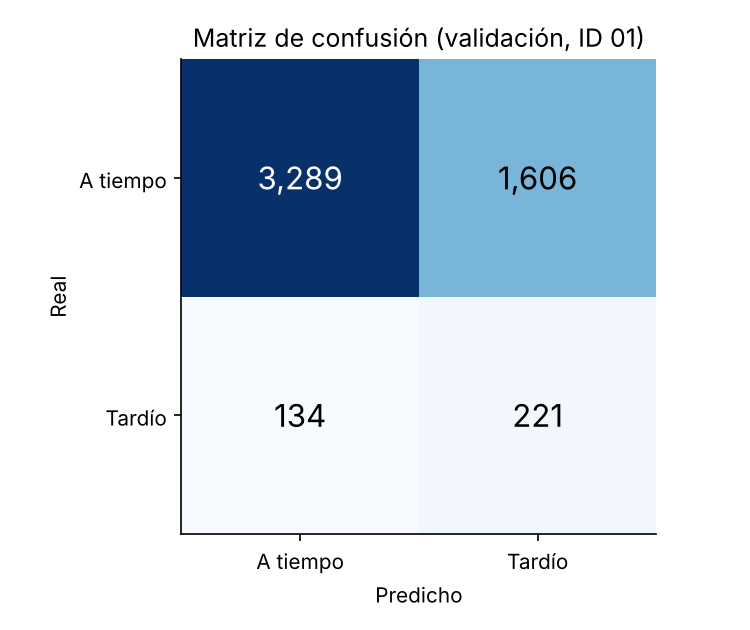
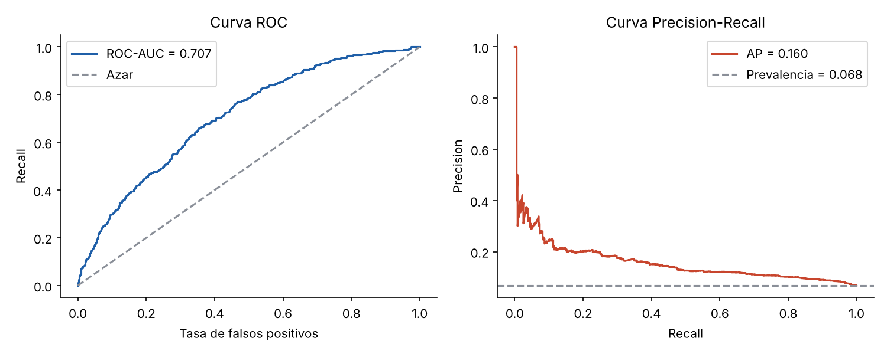
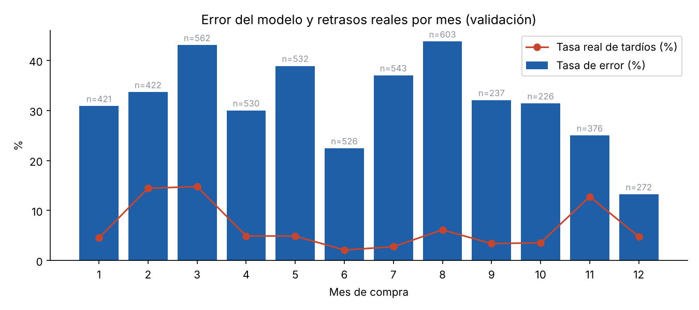
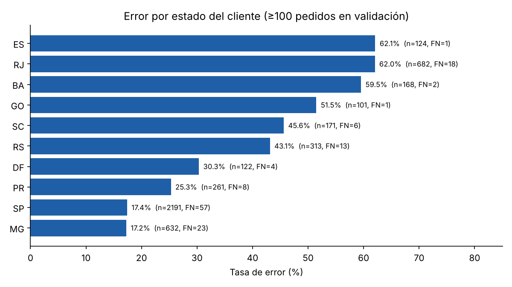
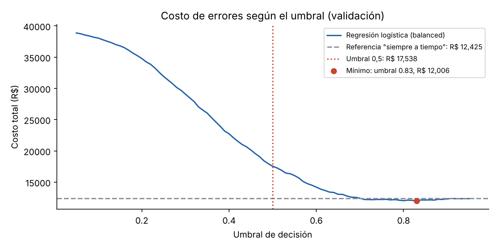

# Laboratorio 1 (S12) · Resumen de resultados — ID 01

**Caso:** predicción de entregas tardías en Olist · **Semilla:** 1001 · **Huella de muestra:** `9e0cf0664d9d`
**Fuente de datos:** Olist, commit `fa0cc6d1aff713d3c8b9a1e633b56889881848bf`

## 1. Datos y partición

| Concepto | Valor |
|---|---|
| Pedidos entregados con fechas coherentes | 96.470 (6,77 % tardíos) |
| Muestra individual | 35.000 pedidos |
| Entrenamiento / validación / prueba | 24.500 / 5.250 / 5.250 |
| Variables predictoras | 28 (24 numéricas, 4 categóricas) |
| Tardíos en validación | 355 (6,76 %) |

El conjunto de prueba no se utilizó en ningún análisis de este laboratorio.

## 2. Modelo y decisión sobre `class_weight`

Regresión logística con el preprocesamiento del cuaderno (imputación por mediana y escalado para numéricas; moda y One-Hot para categóricas) y `max_iter=1000`.

| Modelo (validación) | Accuracy | Precision | Recall | F1 | ROC-AUC | AP | Costo (R$) |
|---|---|---|---|---|---|---|---|
| Referencia (siempre "a tiempo") | 0,932 | – | 0,000 | 0,000 | – | – | 12.425 |
| Reg. logística, `class_weight=None` | 0,933 | 1,000 | 0,003 | 0,006 | 0,713 | 0,160 | 12.390 |
| **Reg. logística, `class_weight='balanced'`** | 0,669 | 0,121 | 0,623 | 0,203 | 0,707 | 0,160 | 17.538 |

Se eligió `'balanced'`: con `None` el modelo emite una sola alerta en 5.250 pedidos y no tiene utilidad operativa. El ponderado no cambia el ordenamiento del riesgo (ROC-AUC y AP casi idénticos); desplaza el punto de corte efectivo.

## 3. Errores por segmento

- **Meses con mayor error:** agosto (43,8 %), marzo (43,1 %), mayo (38,9 %), julio (37,0 %). **Menor error:** diciembre (13,2 %), junio (22,4 %).
- **Estados (≥100 pedidos) con mayor error:** ES (62,1 %), RJ (62,0 %), BA (59,5 %), GO (51,5 %). **Menor error:** MG (17,2 %), SP (17,4 %).
- Las tasas altas en estados con pocos pedidos (RR, SE, PA) no son concluyentes.
- El 92 % de los errores son falsos positivos (1.606 de 1.740).

## 4. Costo empresarial (supuesto: R$ 8 por FP, R$ 35 por FN)

| Componente | Cantidad | Costo (R$) |
|---|---|---|
| Falsos positivos | 1.606 | 12.848 |
| Falsos negativos | 134 | 4.690 |
| **Total** | | **17.538** |

El modelo con umbral 0,5 cuesta un 41 % más que la referencia (R$ 12.425). El menor costo del barrido de umbrales sobre validación (R$ 12.006) ocurre en el umbral 0,83, con Recall de 0,07: solo un 3,4 % mejor que la referencia. Ese umbral se eligió sobre la misma validación, así que el ahorro es optimista.

## 5. Regresión de apoyo

Ridge para estimar `dias_entrega`: **MAE = 5,07 días** en validación.

## 6. Conclusiones y limitaciones

1. Hay señal predictiva moderada (ROC-AUC 0,707; AP 0,160 frente a una prevalencia de 0,068), pero el modelo lineal base es insuficiente para justificar una intervención con estos costos.
2. El error se concentra en rutas y meses específicos (RJ, ES, BA; agosto y marzo), lo que sugiere incorporar información de ruta y estacionalidad.
3. Los costos de R$ 8 y R$ 35 son supuestos didácticos de la guía, no costos verificados de Olist.
4. La partición aleatoria no equivale a una evaluación prospectiva; en la semana 14 se estudiará el orden temporal.

**Plan para la semana 13:** variable de ruta vendedor→cliente con tasa histórica calculada solo con `train`, modelo no lineal con manejo de categóricas y umbral elegido por validación cruzada dentro de `train`; comparar en la misma validación contra esta línea base.

## Archivos de apoyo

`S12_errores_mes_ID_01.csv`, `S12_errores_estado_ID_01.csv`, `S12_barrido_umbral_ID_01.csv` y `S12_resultados_ID_01.json`.
