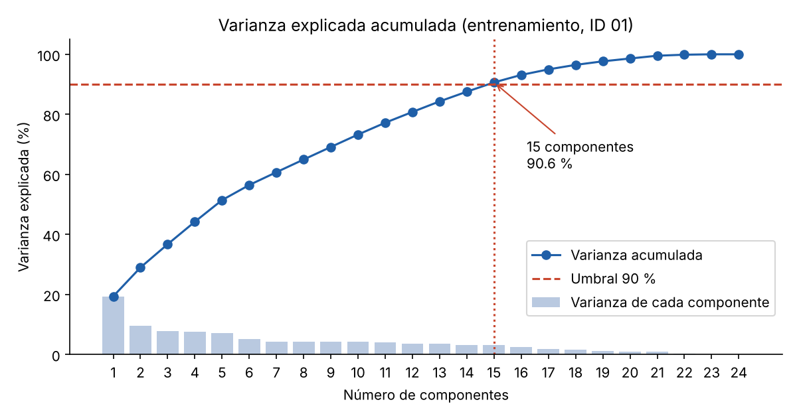
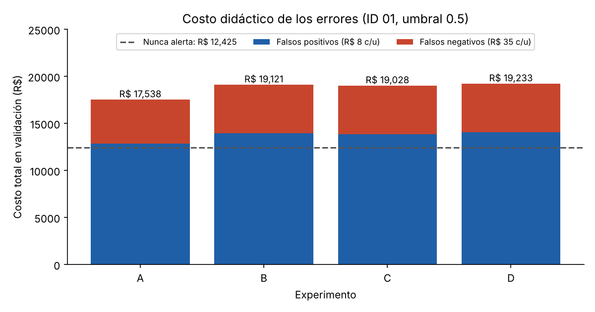
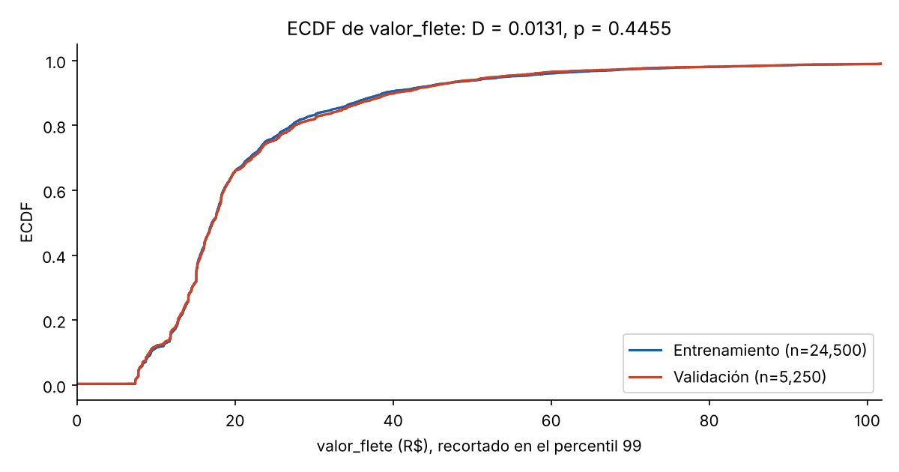

# Laboratorio 2 (S14) · Resumen — ID 01

**Muestra:** semilla 1001, huella `9e0cf0664d9d` · 24,500 entrenamiento / 5,250 validación / 5,250 prueba (reservada).
**Condiciones comunes:** `class_weight='balanced'`, umbral 0.5, costos supuestos R$ 8 por FP y R$ 35 por FN.

## PCA
- Variables numéricas iniciales: **24**; componentes para explicar al menos 90 %: **15** (90.64 % de varianza; se descarta 9.36 %).
- Columnas que recibe el clasificador: 151 sin PCA y 142 con PCA (las categóricas aportan la mayoría).

## Comparación en validación (umbral 0.5)
| Experimento | Accuracy | Precision | Recall | F1 | AP | FP | FN | Costo |
|---|---|---|---|---|---|---|---|---|
| A. Sin PCA, C=1.0 | 0.669 | 0.121 | 0.623 | 0.203 | 0.160 | 1,606 | 134 | R$ 17,538 |
| B. PCA 90 %, C=1.0 | 0.639 | 0.106 | 0.586 | 0.180 | 0.127 | 1,747 | 147 | R$ 19,121 |
| C. PCA 90 %, C=0.1 | 0.642 | 0.107 | 0.583 | 0.181 | 0.129 | 1,731 | 148 | R$ 19,028 |
| D. PCA 90 %, C=10.0 | 0.637 | 0.106 | 0.586 | 0.179 | 0.124 | 1,761 | 147 | R$ 19,233 |

Referencia externa "nunca alerta": Accuracy 0.932, Recall 0, costo **R$ 12,425**.

- Mayor Accuracy: **A** · mayor Recall: **A** · mayor F1: **A** · mayor AP: **A** · menor costo: **A**.
- Efecto de PCA (B frente a A): Recall -0.037, F1 -0.022, AP -0.033, costo R$ +1,583.
- Efecto de C (C y D frente a B): diferencias de costo de R$ -93 y R$ +112, es decir, marginales.
- **Modelo elegido entre los cuatro: A.** Aun así, su costo supera el de "nunca alerta" (precisión 12.1 % frente a una precisión de equilibrio de 18.6 %), por lo que con estos costos supuestos no justificaría una intervención con umbral 0.5.

## Kolmogorov-Smirnov sobre `valor_flete` (entrenamiento vs validación)
- n = 24,500 y 5,250 · **D = 0.0131** · **p = 0.4455** · α = 0.05 → **No rechazar H0**.
- No se rechaza H0, pero eso no demuestra que las distribuciones sean idénticas ni valida el modelo. Hay muchos valores repetidos (81 %), por lo que el valor p es aproximado.

## Archivos
`S14_experimentos_ID_01.csv`, `S14_resultados_ID_01.json` y las tres figuras. No se publican los datos originales ni la muestra de pedidos.
